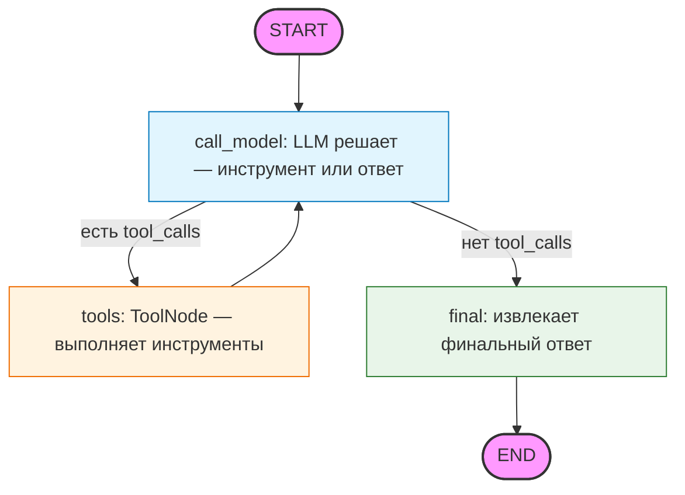

## Agent-Assistant: пет‑проект для развития навыков создания ИИ‑агентов на Python

Agent-Assistant — это pet-проект, созданный для углублённого освоения разработки ИИ‑агентов с использованием языка Python. Основная цель проекта — отработать на практике ключевые подходы и паттерны, применяемые при построении современных агентных систем. Проект построен по архитектуре langgraph, реализует масштабируемый ReAct-цикл.

**Версия:** 1.0

На текущем этапе проект реализует архитектуру RAG (Retrieval‑Augmented Generation): агент умеет извлекать релевантные фрагменты из внешней базы знаний и использовать их для формирования более точных и контекстуально обоснованных ответов. Это позволяет отработать весь цикл работы с векторными представлениями, поиском по семантике и интеграцией LLM.

В дальнейшем планируется поэтапное расширение функциональности:

- добавление разнообразных инструментов (вызовы API, работа с файлами, выполнение скриптов и др.), чтобы агент мог не только отвечать на вопросы, но и совершать действия;

- реализация многоагентной системы, где несколько специализированных агентов будут взаимодействовать между собой, распределять задачи и координировать работу для решения более сложных сценариев.

Проект ориентирован на практическое применение: здесь можно поэкспериментировать с разными библиотеками, сравнить подходы к хранению и поиску данных, протестировать различные стратегии оркестрации агентов и увидеть, как изменения в архитектуре влияют на поведение системы.

### Технологический стек

- Python 3.10\+ — основной язык разработки;
- FastAPI — фреймворк для создания HTTP‑API;
- Uvicorn — ASGI‑сервер для запуска приложения;
- Pytest - тестирование;
- Loguru - логирование;
- sentence-transformers - создание эмбеддингов
- ollama - локальный запуск моделей
- langgraph - реализацмя ReAct-цикла работы агента
- python-magic-bin - проверка типа файлов по содержимому
- sqlalchemy - работа с реляционной базой данных
- alembic - управление миграциями БД
- fastapi-users - регистрация, аутентификация, авторизация пользователей

### Установка

1. Клонируйте репозиторий:

- `git clone <https://git@git.sourcecraft.dev/greatlordorel/agent-assistant.git>`
- `cd agent-assistant`

2. Создайте виртуальное окружение: `python -m venv venv`
3. Активируйте виртуальное окружение:

- **Windows:**
  `venv\Scripts\activate`
- **macOS/Linux:**
  `source venv/bin/activate`

4. Установите зависимости:
   `pip install -r requirements.txt`
5. Заполните файл окружения согласно инструкции в .env.example
6. Выполните миграции `alembic upgrade head`

### Запуск

В версии 0.1 (MVP) для работы проекта требуется локальный запуск Ollama с установленными моделями.

Проект поддерживает разделение конфигурации по средам (dev - локальная разработка, test - тестирование, prod - продакшен)
Запустите сервер с помощью Uvicorn с требуемым значением ENVIRONMENT: например `ENVIRONMENT=dev uvicorn main:app --reload`

### Использование

Взаимодействие пользователя с агентом осуществляется путем отправки POST-запроса на эндпоинт `"/ask"`.
Документация эндпоинтов доступна по адресу `your_host/docs`.

## Граф агента (ReAct + LangGraph)

Диаграмма отражает логику `src.agent.graph`:

### Ограничения и допущения

- в текущей версии реализуется поддержка обработки файлов документации только в формате TXT
- проверка типа документа при чтении не осуществляется, будет реализована в последующих версиях
- «Холодный старт» (индекс векторной БД создаётся один раз при первом запуске)
- для ускорения разработки чанкинг осуществляется по абзацам, в планах тестирование чанкинга по смене смысла с использованием эмбеддингов
- на стадии разработки MVP используется десктопный клиент Ollama, в дальнейшем планируется поддержка Ollama в Docker
- в пакете src.middleware.logging реализована логика получения пользователя путем пасингка JWT-токена, при измемнении стратегии аутентификации потребуется переработка идентификации пользователя
- работа агента тестировалась с LLM qwen2.5, mistral. При работе с qwen2.5 инструметы (tools) вызываются корректно, при работе с mistral вызовы tool_calls не формируются, обработка данной ошибки будет реализована в последующих версиях